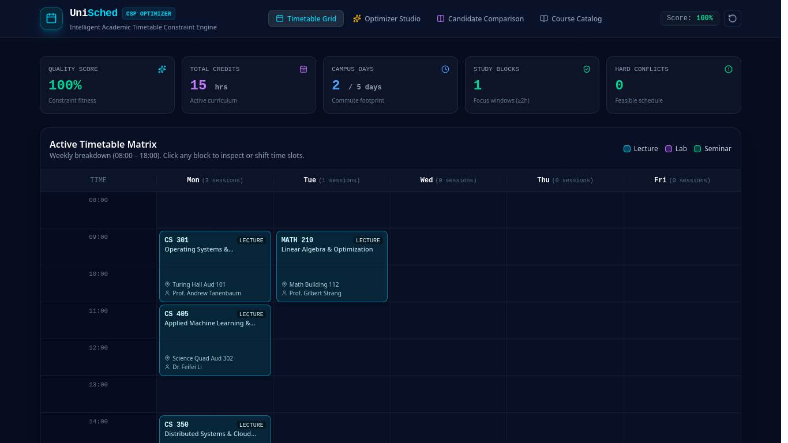

# UniSched — Intelligent Academic Timetable Constraint Engine

> High-performance, client-side Constraint Satisfaction Problem (CSP) solver and timetable optimizer for university students and academic administrators.



## Overview

**UniSched** addresses the complex combinatorial scheduling challenge faced by university students each semester. With overlapping lectures, laboratory sections, conflicting faculty assignments, and personal scheduling constraints, manual timetable generation frequently results in awkward 1-hour dead gaps, excessive commute days, or catastrophic enrollment clashes.

UniSched provides a pure client-side constraint engine leveraging **backtracking with constraint propagation (branch-and-bound)** to automatically compute, score, and rank conflict-free schedules in milliseconds—with zero server dependency.

---

## Key Features

- **Backtracking CSP Solver**: Prunes infeasible time combinations using arc consistency and generates valid multi-course schedules.
- **Multi-Objective Fitness Scoring**: Evaluates timetables across multiple dimensions:
  - **Campus Days Compression**: Minimizes commute days (e.g., 3-day concentrated vs. 5-day scattered).
  - **Gap Elimination**: Penalizes fragmented 1-hour idle periods between lectures.
  - **Deep Study Windows**: Rewards continuous free blocks ($\ge 2$ hours) during academic hours.
  - **Early Morning Penalty**: Configurable avoidance of 08:00 AM class starts.
- **Interactive Weekly Timetable Grid**: 5-day matrix (Mon–Fri, 08:00–18:00) with interactive drag-and-drop / click-to-shift controls.
- **Real-Time Clash Detection**: Instantly flags room collisions, faculty double-booking, and course overlap conflicts.
- **Candidate Comparison Studio**: Side-by-side trade-off matrix comparing candidate timetables across fitness metrics, daily footprint, and enrolled credits.
- **Department Course Catalog**: Searchable registry supporting custom sections, credit allocations, and lecture/lab/seminar typology.
- **Local Persistence & Deterministic Reset**: All modifications, custom sections, and active preferences persist locally in browser storage with instant reset-demo-data capability.

---

## Technical Stack

| Layer | Technology |
|---|---|
| Framework | React 19 + TypeScript |
| Build Tool | Vite |
| Styling | Tailwind CSS v4 |
| State Management | Zustand |
| Icons | Lucide React |
| Testing | Vitest + React Testing Library |
| CSP Engine | In-browser Deterministic Backtracking & Scoring |

---

## Getting Started

### Prerequisites

- Node.js $\ge 18$
- pnpm $\ge 8$

### Installation & Development

```bash
# Clone the repository
git clone git@github.com:Sanyam-Ahuja/unisched.git
cd unisched

# Install dependencies
pnpm install

# Run development server
pnpm dev

# Execute unit test suite
pnpm test

# Build for production
pnpm build
```

---

## Constraint Architecture

```text
Student Course Requirements + Soft Preferences
                  │
                  ▼
       [ CSP Backtracking Engine ]
        - Prunes Overlapping Slots
        - Verifies Room & Faculty Availability
        - Explores Feasible Tree Branches
                  │
                  ▼
       [ Multi-Objective Scorer ]
        - Commute Days (Weight: 25)
        - Idle Gaps (Penalty: -15 / gap)
        - Study Blocks (Bonus: +10 / block)
        - Morning Starts (Penalty: -10 / class)
                  │
                  ▼
       [ Ranked Candidates 01..04 ]
                  │
                  ▼
       [ Interactive Weekly Timetable ]
```

---

## License

MIT © 2026 UniSched. Built for Smart Campus & Student Life Portfolio.
